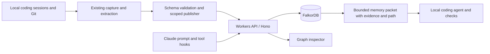

# Org Memory × FalkorDB

**The next coding session should know why.** Evidence-backed memory that connects a fresh coding session to useful discoveries from past work, then shows the relationship path behind each retrieved fact.

Built for [Graph Hacks: Context for AI Agents](https://www.wemakedevs.org/hackathons/falkordb), Track 01 (Agents That Act on Connected Data), with a memory workflow relevant to Track 02.

## What works

- Real FalkorDB nodes, typed relationships, and parameterized Cypher traversals through a Cloudflare Workers / Hono API.
- Strict schemas for facts, decisions, problems, sources, files, and work. The server creates evidence stamps; callers cannot assert `verified: true`.
- Organization/repository scopes derived from bearer credentials, reader/writer roles, bounded context, same-session exclusion, and code fingerprint checks.
- Versioned snapshots, writer conflict detection, explicit supersession, and a local publisher that preserves teammates' knowledge.
- Claude hook delivery through the shared API, with duplicate suppression, session budgets, and fail-open behavior.
- A browser inspector showing actual graph data, evidence, relationship paths, executed Cypher, parameters, returned row counts, and timings.
- A reproducible synthetic demo: memory selects an allowlisted compatibility test, a proposed removal fails, and a compatibility-preserving simplification passes all four fixture tests.

**Current delivery is local.** The Workers runtime and FalkorDB run as separate processes. A production Cloudflare deployment and a live Claude task have not been verified. The demo uses synthetic knowledge and a deterministic policy, not an LLM performance benchmark.

## Quick start

Requires Node.js 24+ and either Docker or Python 3.10+ for the database. No LLM API key or Claude account is needed for the inspector, tests, or deterministic demo.

```sh
git clone https://github.com/naveenkumarrk/org-memory-falkordb.git
cd org-memory-falkordb
npm ci
npm run setup:local
docker compose up -d
npm run dev
```

In another terminal, from the same directory:

```sh
npm run demo:seed
npm run demo:agent
```

Open **http://127.0.0.1:8787**. Submit the prefilled request, inspect a memory's evidence/path, and expand **Inspect executed FalkorDB queries**. Uncheck graph relationships and retrieve again: this scenario returns zero eligible memories without expansion.

The Docker setup follows the [official FalkorDB getting-started guide](https://docs.falkordb.com/getting-started), using its official Node client. This project's Compose file binds the database to localhost on port **16379**.

### Without Docker

Instead of `docker compose up -d`, run:

```sh
python3 -m venv .venv
.venv/bin/pip install falkordblite==0.10.0
.venv/bin/python scripts/start-falkor.py
```

Keep that terminal running and start `npm run dev` in another. The embedded option runs a real FalkorDB engine through the official FalkorDBLite package; it is not an in-memory graph mock.

## Reproduce the demonstration

With the API/database running:

```sh
npm run demo:verify
```

This publishes synthetic memory, queries the graph, compares expansion on/off, rejects a changed file fingerprint, delivers a packet through the actual hook process using a synthetic Claude event, runs the code-change demo, publishes replacement evidence, and checks that old knowledge stops being recalled. It restores the starting fixture afterwards.

Results and actual query/test output are saved in [docs/demo-proof.json](docs/demo-proof.json). Commands, a recording outline, and submission text are in [docs/DEMO.md](docs/DEMO.md) and [docs/SUBMISSION.md](docs/SUBMISSION.md).

| Scenario | Observed result |
| --- | --- |
| Graph traversal enabled | 2 memories, through past work |
| Direct file relationships only | 0 memories |
| Code fingerprint changed | 0 memories; revalidation warning |
| Hook called twice in one synthetic session | Context delivered once |
| Legacy parsing removed | Compatibility test fails; process exits 1 |
| Compatibility-preserving simplification | All 4 fixture tests pass; process exits 0 |
| Explicit migration evidence published | Only the replacement fact is returned |

These are observations from one deliberately constructed scenario, not estimates of general retrieval accuracy. Timings in the proof file are individual local measurements.

## Architecture and data model



Actual graph labels include `Work`, `File`, `Fact`, `Decision`, `Problem`, `Session`, and `Commit`; actual relationships include `TOUCHED`, `LEARNED`, `ABOUT`, `DECIDED`, and `SUPERSEDES`. Validated node-specific payloads and provenance are also stored as JSON properties for round-trip fidelity. FalkorDB executes retrieval and path expansion; the client does not reconstruct a graph in the browser to answer queries.

In the fixture, the fact links directly to the mobile client. A request about authentication reaches it through past work:

```text
authentication.ts ← TOUCHED — past work — LEARNED → mobile-client fact
```

See [worker/schema.ts](worker/schema.ts) for the schema and [worker/graph.ts](worker/graph.ts) for database queries. Retrieval is lexical/file anchored with bounded graph expansion; embeddings are not implemented.

**Evidence semantics:** finding a quote in its supplied excerpt establishes source grounding, not behavioral truth or an independently authenticated source. Git observations are supplied by the trusted local adapter. Test outcomes are labeled client-reported execution. Older records lacking a retained source excerpt are marked unverified and excluded from recall. Synthetic evidence is labeled explicitly.

**Updates:** a publisher stages an immutable version and atomically advances a current-version pointer. Supersession preserves old nodes/history while excluding retired facts from recall. It does not infer replacements merely from timestamps. Historical version garbage collection, sophisticated contradiction resolution, and production identity administration remain future work. Writers are trusted ingest principals; conflicting writes receive HTTP 409.

## Try the Claude integration

Claude Code must be installed and authenticated separately. To prepare isolated, recall-only settings:

```sh
npm run demo:hooks
cd .demo/workspace/commerce
claude --settings /ABSOLUTE/PATH/TO/org-memory-falkordb/.demo/hook-home/hooks.settings.json
```

Ask: `Simplify src/authentication.ts without breaking existing clients. Inspect relevant memory and run the compatibility checks before choosing your change.`

These settings do not enable capture or install global hooks. See [docs/SETUP.md](docs/SETUP.md) to configure real scoped capture/publishing and hosted deployment. Do not publish real session records using the public demo identity; it accepts synthetic evidence only.

## Verification

```sh
FALKORDB_URL=redis://127.0.0.1:16379 npm test
npm run typecheck
npm run deploy:check
```

The test suite includes actual FalkorDB traversal, namespace isolation, supersession, writer conflicts, source grounding, API authorization, freshness, repository exclusions, hook delivery/budgets, and fail-open behavior. Without `FALKORDB_URL`, the database integration test is skipped. Type checking covers the new Worker graph/API modules and their schema/integration tests. GitHub Actions runs the suite with a real FalkorDB service and checks the Worker bundle.

## Provenance and reuse

This independent public repository preserves the history of the private `naveenkumarrk/org-memory` project at baseline `893e5d4`. The original project remains separate. Capture, extraction, local Git inspection, hooks, SQLite baseline compiler, and earlier evaluation tooling are inherited. New event work adds FalkorDB persistence/traversal, Workers API, typed evidence validation, scoped publishing, update handling, graph inspector, synthetic fixtures, and regression tests.

SQLite remains available for legacy local commands and as an in-memory import compiler. Shared recall and the new inspector use FalkorDB exclusively. The inherited README's private benchmark claims have not been reproduced for this edition.

See [baseline assessment](docs/BASELINE.md), [hackathon scope](docs/HACKATHON.md), [original README](docs/UPSTREAM_README.md), and [open-source dependencies](docs/DEPENDENCIES.md).
